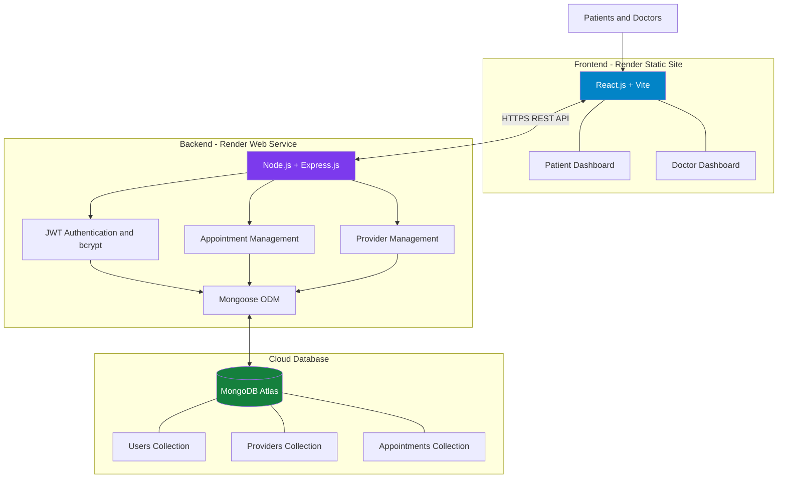
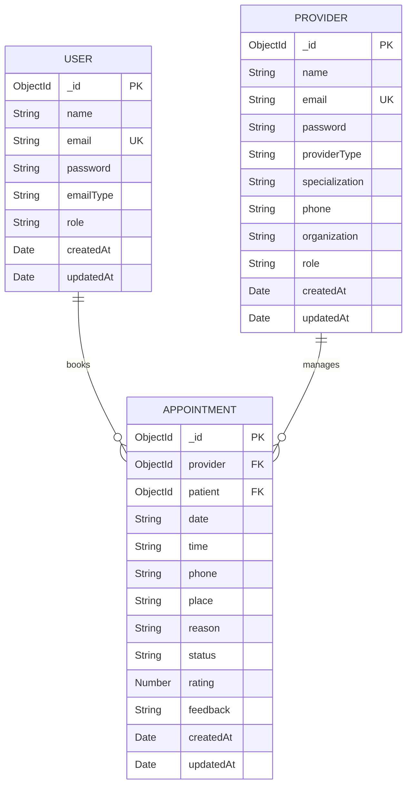
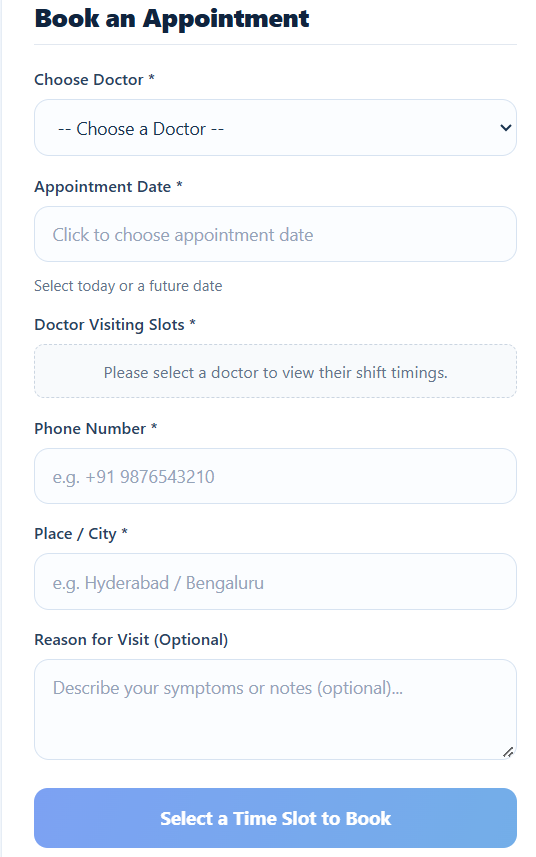
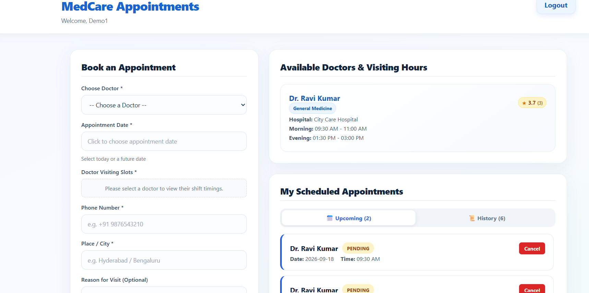

# MedCare - Appointment Booking System

MedCare is a full-stack web application for booking and managing healthcare appointments. Patients can browse doctors, schedule appointments and track their booking status. Doctors can manage appointment requests through a separate dashboard.

I built this project to gain hands-on experience in full-stack development, authentication, REST APIs, database management and application deployment.

## Live Demo

- [Live Application](https://appointment-booking-system-2uz6.onrender.com)
- [Backend API Health Check](https://appointment-api-1p7q.onrender.com/api/health)

## Features

### Patient Portal

- Patient registration and login
- Browse doctors and their specializations
- Book and cancel appointments
- Track appointment status
- View appointment history
- Submit doctor ratings and reviews

### Doctor Portal

- Doctor authentication
- Doctor profile and performance overview
- View upcoming appointments
- Accept or reject appointment requests
- View past appointments and patient reviews

## Technologies Used

| Technology | Purpose |
|---|---|
| React.js | Frontend development |
| CSS | User interface styling |
| Vite | Frontend build tool |
| Node.js | Backend runtime |
| Express.js | REST API development |
| MongoDB Atlas | Cloud database |
| Mongoose | Database modeling |
| JWT | Authentication |
| bcrypt | Password hashing |
| Git and GitHub | Version control |
| Render | Application deployment |

## Project Structure

```text
Appointment-Booking-System/
├── client/
│   ├── src/
│   │   ├── App.jsx
│   │   ├── App.css
│   │   └── config.js
│   └── package.json
├── server/
│   ├── models/
│   ├── routes/
│   │   ├── authRoutes.js
│   │   ├── providerRoutes.js
│   │   └── appointmentRoutes.js
│   ├── middleware/
│   ├── server.js
│   └── package.json
├── screenshots/
│   ├── login.png
│   ├── registration.png
│   ├── patient-dashboard.png
│   ├── appointment-booking.png
│   ├── doctor-dashboard.png
│   └── appointment-history.png
├── .gitignore
└── README.md
```

## System Architecture

MedCare follows a three-tier architecture that separates the user interface, backend business logic and database.



### Architecture Overview

- **Presentation Layer:** React.js and Vite provide the patient and doctor interfaces.
- **Application Layer:** Node.js and Express.js handle REST API requests and business logic.
- **Authentication Layer:** JWT and bcrypt support authentication and password security.
- **Data Layer:** MongoDB Atlas stores user, provider and appointment records through Mongoose.
- **Deployment:** The frontend and backend are hosted separately on Render.

## REST API Documentation

The backend provides 13 API endpoints, including patient authentication, doctor management, appointment scheduling, status updates, reviews and server health checks.

### Base URLs

- Local: `http://localhost:5000`
- Production: `https://appointment-api-1p7q.onrender.com`

### Patient Authentication APIs

| Method | Endpoint | Description | Authentication |
|---|---|---|---|
| POST | `/api/auth/register` | Register a new patient | No |
| POST | `/api/auth/login` | Authenticate a patient | No |
| GET | `/api/auth/profile` | Retrieve patient profile | JWT |

### Doctor APIs

| Method | Endpoint | Description | Authentication |
|---|---|---|---|
| GET | `/api/provider` | Retrieve doctors | No |
| POST | `/api/provider/login` | Authenticate a doctor | No |
| GET | `/api/provider/appointments` | Retrieve doctor appointments | JWT |

### Appointment APIs

| Method | Endpoint | Description | Authentication |
|---|---|---|---|
| GET | `/api/appointments` | Retrieve appointments | JWT |
| POST | `/api/appointments` | Book a new appointment | JWT |
| DELETE | `/api/appointments/:id` | Cancel an appointment | JWT |
| PATCH | `/api/appointments/:id/status` | Update appointment status | JWT |
| PATCH | `/api/appointments/:id/review` | Submit rating and review | JWT |

### Server Status APIs

| Method | Endpoint | Description | Authentication |
|---|---|---|---|
| GET | `/` | Backend root endpoint | No |
| GET | `/api/health` | Check API availability | No |

### API Authentication

Protected endpoints require a valid JWT token in the Authorization header.

```http
Authorization: Bearer YOUR_JWT_TOKEN
Content-Type: application/json
```

### Health Check Example

Request:

```http
GET /api/health
```

Response:

```json
{
  "success": true,
  "message": "Appointment API is running"
}
```

The frontend and backend communicate using REST APIs and JSON.
## Database Design

MedCare uses MongoDB Atlas as its cloud database and Mongoose for schema definition, validation and database operations.

The database consists of three primary collections: Users, Providers and Appointments.

### Entity Relationship Diagram



### Users Collection

Stores patient account information and authentication details.

| Field | Data Type | Description |
|---|---|---|
| _id | ObjectId | Unique patient identifier |
| name | String | Patient name |
| email | String | Unique email address |
| password | String | Password hash |
| emailType | String | Personal or office email |
| role | String | Defaults to user |
| createdAt | Date | Account creation timestamp |
| updatedAt | Date | Last modification timestamp |

### Providers Collection

Stores doctor and service provider profiles.

| Field | Data Type | Description |
|---|---|---|
| _id | ObjectId | Unique provider identifier |
| name | String | Provider name |
| email | String | Unique email address |
| password | String | Password hash |
| providerType | String | Doctor, staff or service-provider |
| specialization | String | Professional specialization |
| phone | String | Contact number |
| organization | String | Associated organization |
| role | String | Defaults to provider |
| createdAt | Date | Profile creation timestamp |
| updatedAt | Date | Last modification timestamp |

### Appointments Collection

Stores appointment bookings, scheduling information, status and patient feedback.

| Field | Data Type | Description |
|---|---|---|
| _id | ObjectId | Unique appointment identifier |
| provider | ObjectId | Reference to Provider |
| patient | ObjectId | Reference to User |
| date | String | Appointment date |
| time | String | Appointment time |
| phone | String | Patient contact number |
| place | String | Appointment location |
| reason | String | Reason for appointment |
| status | String | Current appointment status |
| rating | Number | Patient rating from 1 to 5 |
| feedback | String | Patient review |
| createdAt | Date | Booking creation timestamp |
| updatedAt | Date | Last modification timestamp |

### Database Relationships

- One patient can book multiple appointments.
- One provider can manage multiple appointments.
- Each appointment references one patient and one provider using MongoDB ObjectId references.

### Schema Validation

- Unique email indexes for patient and provider accounts.
- Required field validation.
- Email normalization using lowercase and trim.
- Enum validation for account types and appointment status.
- Rating validation between 1 and 5.
- Automatic creation and modification timestamps.
- Default values for optional fields.

### Appointment Status Values

| Status | Description |
|---|---|
| pending | Appointment awaiting confirmation |
| confirmed | Appointment confirmed |
| completed | Appointment completed |
| cancelled | Appointment cancelled |

New appointments are assigned the pending status by default.


## Installation and Setup

### Prerequisites

- Node.js and npm
- Git
- MongoDB Atlas account or local MongoDB instance

### Clone the Repository

```bash
git clone https://github.com/Tarun45-dot/Appointment-Booking-System.git
cd Appointment-Booking-System
```

### Backend Setup

```bash
cd server
npm install
```

Create a `.env` file inside the server directory:

```env
PORT=5000
MONGODB_URI=your_mongodb_connection_string
JWT_SECRET=your_jwt_secret
```

Start the backend:

```bash
node server.js
```

### Frontend Setup

Open a separate terminal from the project root:

```bash
cd client
npm install
npm run dev
```

### Local Development URLs

- Frontend: http://localhost:5173
- Backend: http://localhost:5000

## Deployment

The application is deployed on Render and uses MongoDB Atlas as its cloud database. Source code is maintained on GitHub.

| Component | Platform |
|---|---|
| Frontend | Render Static Site |
| Backend | Render Web Service |
| Database | MongoDB Atlas |
| Source Code | GitHub |

The production frontend uses the `VITE_API_URL` environment variable to communicate with the deployed backend.

## Application Screenshots

### Login Page


### Patient Registration



### Patient Dashboard



### Appointment Booking


### Doctor Dashboard


### Appointment History


## Developer

**Tarun Kumar Reddy Vunadi**

B.Tech - Computer Science and Engineering

Vignan's Foundation for Science, Technology & Research

[GitHub](https://github.com/Tarun45-dot) | [LinkedIn](https://www.linkedin.com/in/tarun-kumar-reddy-vunadi-822a4133a)
