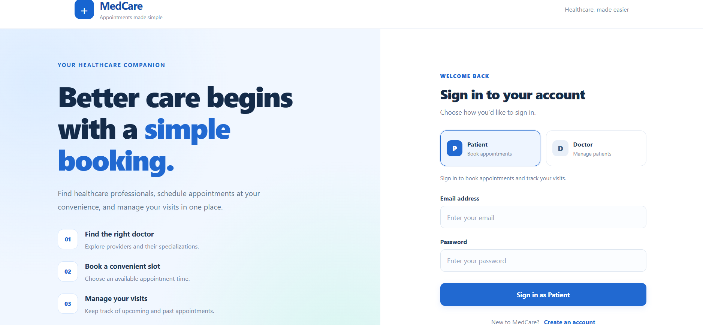
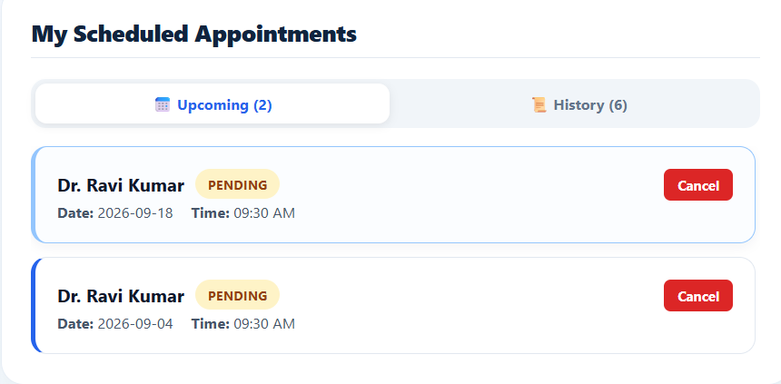
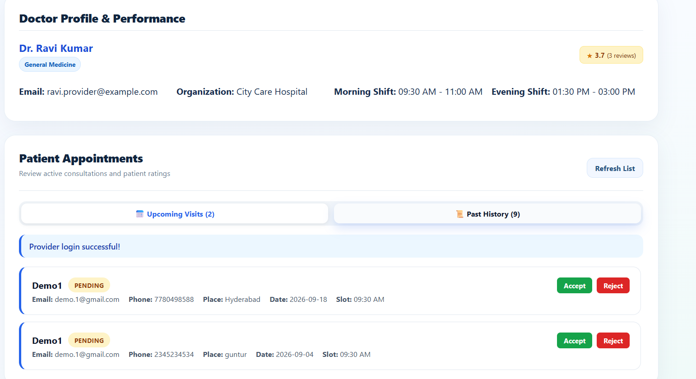
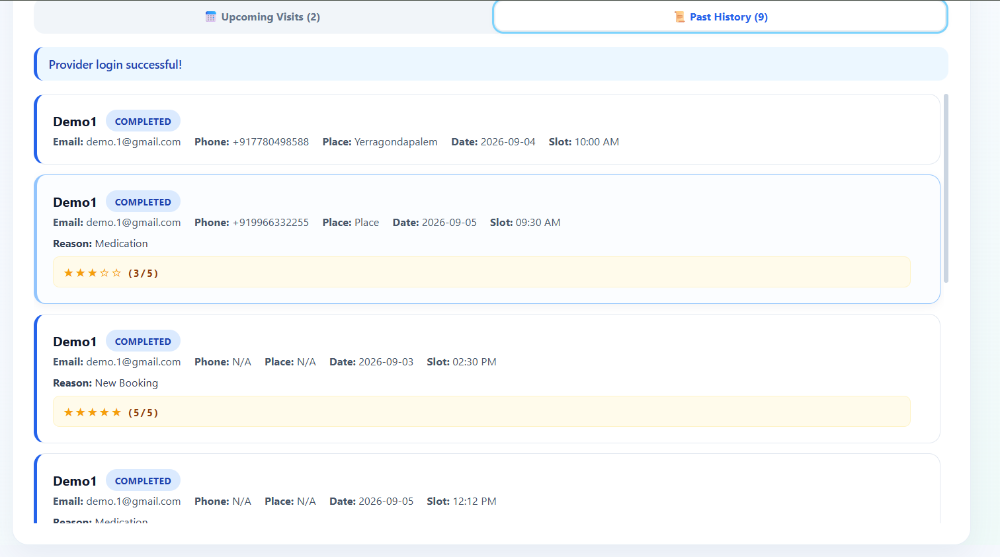

# MedCare - Appointment Booking System

MedCare is a full-stack web application for booking and managing healthcare appointments. Patients can browse doctors, schedule appointments and track their booking status. Doctors can manage appointment requests through a separate dashboard.

I built this project to gain hands-on experience in full-stack development, authentication, REST APIs, database management and application deployment.

## Live Demo

[View Application](https://appointment-booking-system-2uz6.onrender.com)

## Features

### Patient Portal
- Patient registration and login
- Browse doctors and their specializations
- Book and cancel appointments
- Track appointment status
- View appointment history
- Submit doctor ratings and reviews

### Doctor Portal
- Doctor authentication
- Doctor profile and performance overview
- View upcoming appointments
- Accept or reject appointment requests
- View past appointments and patient reviews

## Technologies Used

| Technology | Purpose |
|---|---|
| React.js | Frontend development |
| CSS | User interface styling |
| Vite | Frontend build tool |
| Node.js | Backend runtime |
| Express.js | REST API development |
| MongoDB Atlas | Cloud database |
| Mongoose | Database modeling |
| JWT | Authentication |
| bcrypt | Password hashing |
| Git and GitHub | Version control |
| Render | Application deployment |

## Project Structure

```
Appointment-Booking-System/
├── client/
│   ├── src/
│   │   ├── App.jsx
│   │   ├── App.css
│   │   └── config.js
│   └── package.json
├── server/
│   ├── models/
│   ├── routes/
│   ├── middleware/
│   ├── server.js
│   └── package.json
├── .gitignore
└── README.md
```

## Application Architecture

The frontend is developed using React and communicates with the Express backend through REST APIs. MongoDB Atlas stores patient, doctor and appointment information.

The application uses JWT-based authentication and bcrypt password hashing to manage user access.

## Installation and Setup

Clone the repository:

```bash
git clone https://github.com/Tarun45-dot/Appointment-Booking-System.git
cd Appointment-Booking-System
```

### Backend Setup

```bash
cd server
npm install
```

Create a `.env` file inside the server directory:

```env
PORT=5000
MONGODB_URI=your_mongodb_connection_string
JWT_SECRET=your_jwt_secret
```

Start the backend:

```bash
node server.js
```

### Frontend Setup

Open a separate terminal from the project root:

```bash
cd client
npm install
npm run dev
```

Local development URLs:

- Frontend: http://localhost:5173
- Backend: http://localhost:5000
## Deployment

The application is deployed on Render and uses MongoDB Atlas as its cloud database. Source code is maintained on GitHub.

## Application Screenshots

### Login Page


### Patient Registration


### Patient Dashboard


### Appointment Booking


### Doctor Dashboard


### Appointment History


## Developer

Tarun Kumar Reddy Vunadi

[GitHub](https://github.com/Tarun45-dot) | [LinkedIn](https://www.linkedin.com/in/tarun-kumar-reddy-vunadi-822a4133a)
